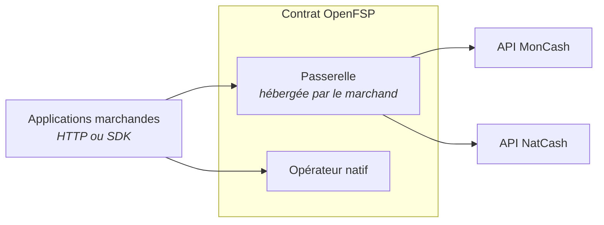

<picture>
  
</picture>

**Une norme ouverte pour intégrer les paiements en Haïti**

[Read in English](README.md)

OpenFSP fixe un seul contrat ouvert entre les applications marchandes et les opérateurs de
paiement haïtiens. L'opérateur l'implémente une fois ; l'application le parle une fois et
fonctionne avec tous les opérateurs compatibles.

## L'idée

Sans contrat commun, chacune des `L` applications marchandes intègre chacun des `O`
opérateurs : `O × L` intégrations. Avec OpenFSP, chaque application utilise un seul
protocole et chaque opérateur implémente ce contrat une seule fois : `O + L`.

Un opérateur natif parle OpenFSP sans intermédiaire. En attendant, la passerelle traduit le
contrat vers les API actuelles de MonCash et NatCash : il sert dès aujourd'hui.

## Composants

| Composant | Rôle |
|---|---|
| **Spécification** | Le contrat : modèle de données, cycle de vie, capacités, erreurs, idempotence, webhooks, authentification, conformité. |
| **Passerelle** | Une implémentation, hébergée par le marchand : OpenFSP d'un côté, API de MonCash et NatCash de l'autre. |
| **Simulateur** | Joue les opérateurs, pannes comprises, ainsi qu'un opérateur OpenFSP natif, pour tester sans compte marchand. |
| **SDK** | La prochaine étape : Kotlin pour la JVM d'abord, puis TypeScript. Le protocole s'utilise aussi en HTTP seul. |
| **Suite de conformité** | Vérifie une passerelle ou un opérateur natif par rapport à la spécification ; chacun peut la relancer. |

## Pour aller plus loin

- Spécification, décisions et état du projet : [openfsp.org](https://openfsp.org/fr)
- Code : [openfspht/openfsp](https://github.com/openfspht/openfsp)
- Gouvernance : [openfspht/governance](https://github.com/openfspht/governance)
- Licence : [Apache-2.0](https://github.com/openfspht/governance/blob/main/LICENSE)

**Contribuer** : Karako Systems reçoit relectures et propositions par le
[processus de décision](https://openfsp.org/fr/docs/decisions), selon
[CONTRIBUTING.md](https://github.com/openfspht/governance/blob/main/CONTRIBUTING.md).
