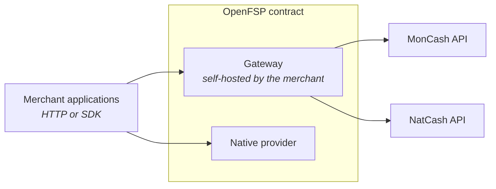

<picture>
  
</picture>

**An open standard for payment integration in Haiti**

[Lire en français](README.fr.md)

OpenFSP is one open contract between merchant applications and Haitian payment service
providers. A provider implements it once; a merchant application speaks it once and works
with every compatible provider.

## The idea

Without a shared contract, each of `L` merchant applications integrates each of `O`
providers: `O × L` integrations. With OpenFSP, each application speaks one protocol and
each provider implements that contract once: `O + L`.

A native provider speaks OpenFSP directly. Until providers do, the gateway translates the
contract into the existing MonCash and NatCash APIs, so it is usable today.

## Components

| Component | Role |
|---|---|
| **Specification** | The contract: data model, lifecycle, capabilities, errors, idempotency, webhooks, authentication, conformance. |
| **Gateway** | One implementation, self-hosted by the merchant: OpenFSP in, MonCash and NatCash APIs out. |
| **Simulator** | Plays the providers, failures included, and a native OpenFSP provider, for testing without a merchant account. |
| **SDKs** | Kotlin for the JVM on Maven Central (`org.openfsp:openfsp-sdk`) and TypeScript on npm (`@openfsp/sdk`). The protocol also works over plain HTTP. |
| **Conformance suite** | Checks a gateway or a native provider against the specification; anyone can rerun it. |

## Read next

- Specification, decisions and status: [openfsp.org](https://openfsp.org)
- Code: [openfspht/openfsp](https://github.com/openfspht/openfsp)
- Governance: [openfspht/governance](https://github.com/openfspht/governance)
- License: [Apache-2.0](https://github.com/openfspht/governance/blob/main/LICENSE)

**Contributing**: Karako Systems takes reviews and proposals through the
[decision process](https://openfsp.org/docs/decisions), following
[CONTRIBUTING.md](https://github.com/openfspht/governance/blob/main/CONTRIBUTING.md).
