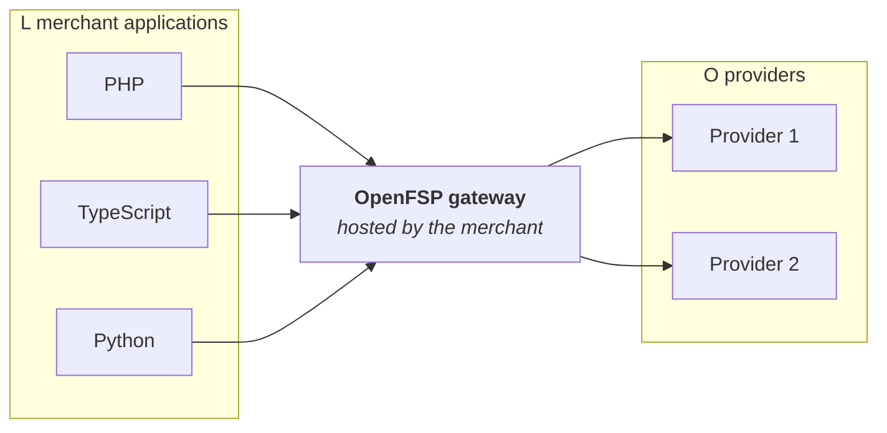

<picture>
  <source media="(prefers-color-scheme: dark)" srcset="https://cdn.openfsp.org/logo/openfsp-logo-inverse.svg">
  
</picture>

**A proposed open standard for payment integration in Haiti**

[Lire en français](README.fr.md)

OpenFSP is the research project I propose for my MBDS master's degree: a single open
contract between merchant applications and Haitian digital payment providers. It is
academic work first; I will open it to contribution afterwards.

## The idea

Without a common contract, each of `L` merchant applications integrates each of `O`
providers: `O × L` integrations. With OpenFSP, each application speaks one protocol and each
provider is integrated once, in the gateway: `O + L`.

## Components

| Component | Role |
|---|---|
| **Specification** | The contract: data model, lifecycle, capabilities, errors, idempotency, webhooks. |
| **Gateway** | Server the merchant hosts: OpenFSP protocol in, provider APIs out. |
| **Mock server** | Reproduces providers, failures included, for testing without a merchant account. |
| **Client libraries** | Thin clients for TypeScript, PHP and Python; the protocol also works over plain HTTP. |
| **Conformance suite** | Checks that an implementation follows the specification; any third party can rerun it. |

## Read next

Specification and ADRs: [openfspht/adrs](https://github.com/openfspht/adrs). Governance:
[GOVERNANCE.md](https://github.com/openfspht/openfsp/blob/main/GOVERNANCE.md). Licence:
[Apache-2.0](https://github.com/openfspht/openfsp/blob/main/LICENSE).

**Contributing**: I welcome reviews and proposals through the
[ADR process](https://github.com/openfspht/adrs), following
[CONTRIBUTING.md](https://github.com/openfspht/openfsp/blob/main/CONTRIBUTING.md).
